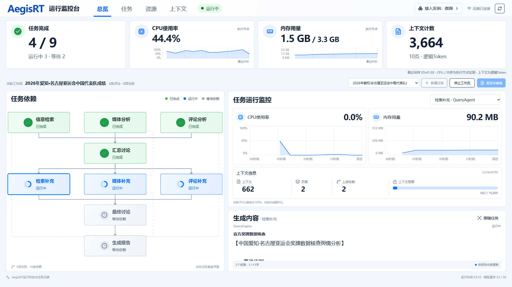
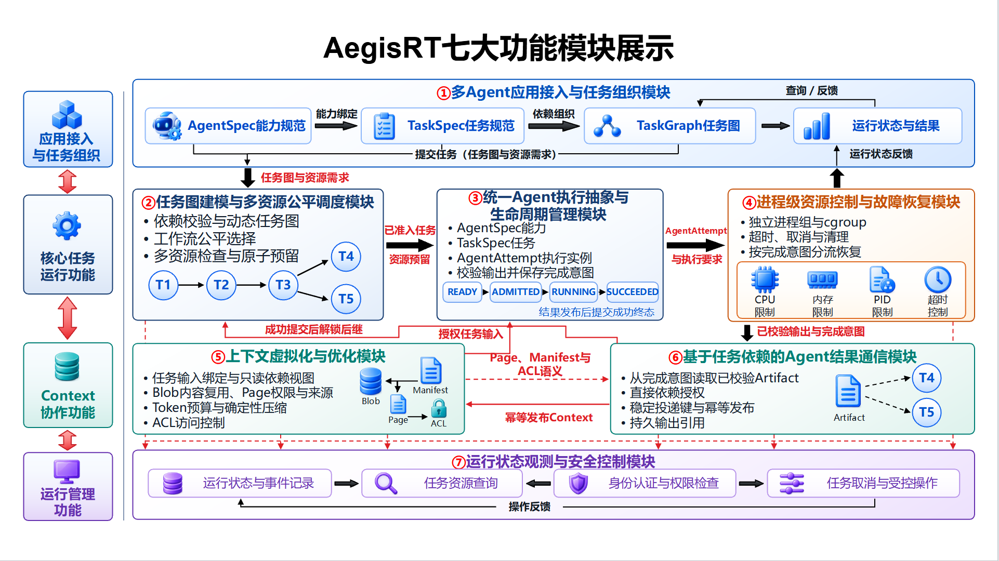

<div align="center">

# 🛡️ AegisRT · 多智能体协同运行时

**依赖感知调度 · 上下文治理 · 任务恢复**

基于openEuler/Linux，为多智能体应用提供统一、受控且可恢复的执行支持。

🏆 **第三届中国研究生操作系统开源创新大赛三等奖**


[](src/aegisrt/LICENSE)


[快速开始](#快速开始) · [系统架构](#系统架构) · [核心机制](#核心机制) · [运行展示](#运行展示) · [测试与验证](#测试与验证) · [技术文档](#技术文档)

</div>

---

## 项目简介

AegisRT是一套基于openEuler/Linux的多智能体协同运行时系统，面向多智能体应用中的任务依赖、资源竞争、上下文共享和异常恢复问题，为上层应用提供统一、受控且可恢复的执行支持。系统位于应用与操作系统之间，将协作需求转化为明确的任务关系、资源约束和执行状态，使应用开发者能够集中处理业务逻辑，并通过统一接口管理智能体运行过程。

系统以智能体能力描述和任务图为入口，统一完成依赖校验、调度准入、上下文组装、进程执行、结果发布、资源回收与状态保存。核心运行时使用Go实现，以单机守护进程形式部署，通过openEuler/Linux的进程组和cgroup v2落实执行边界，并提供HTTP API、命令行和Web控制台。

AegisRT适用于需要并行执行、交换中间结果并汇合产出的多智能体任务，例如资料研究、舆情分析、代码仓库分析和运维协同。应用接入时定义Agent能力、任务依赖与资源需求，运行时统一管理任务的执行过程。

[](docs/assets/runtime-monitor.png)

<p align="center">任务依赖、执行进度、资源状态与Agent产出，一处查看。</p>

## 系统架构

[](docs/assets/runtime-architecture.png)

上层应用通过AgentSpec与TaskSpec描述执行能力和任务，TaskGraph维护依赖关系；运行时协调调度、资源账本、上下文和Worker执行，底层由openEuler/Linux提供进程与资源控制。状态观测和安全控制贯穿整个执行过程。

| 功能模块 | 主要能力 | 实现入口 |
|---|---|---|
| 任务图建模与多资源公平调度 | 动态DAG校验、工作流公平选择、任务评分与原子资源预留 | [taskgraph](src/aegisrt/internal/taskgraph/)、[scheduler](src/aegisrt/internal/scheduler/) |
| 统一Agent执行抽象与生命周期管理 | 使用AgentSpec、TaskSpec和AgentAttempt关联能力、任务与每次执行 | [domain](src/aegisrt/internal/domain/)、[worker](src/aegisrt/internal/worker/) |
| 进程级资源控制与故障恢复 | 进程组与cgroup v2隔离，CPU、内存和PID约束，超时、取消及任务边界恢复 | [resourcecontrol](src/aegisrt/internal/resourcecontrol/)、[runtimecore](src/aegisrt/internal/runtimecore/) |
| 上下文虚拟化与优化 | 内容复用、来源追踪、ACL访问控制与Token预算组装 | [contextvm](src/aegisrt/internal/contextvm/)、[contextstate](src/aegisrt/internal/contextstate/) |
| 基于任务依赖的Agent结果通信 | 按直接依赖授权传递产物，维护稳定投递键与幂等发布记录 | [contextdispatch](src/aegisrt/internal/contextdispatch/)、[contextstate](src/aegisrt/internal/contextstate/) |
| 运行状态观测与安全控制 | 任务与资源查询、事件记录、身份认证和受控操作 | [api](src/aegisrt/internal/api/)、[webconsole](src/aegisrt/internal/webconsole/) |
| 多Agent应用接入与任务组织 | 将业务引擎适配为进程型Agent，组织并行任务、依赖汇合与反馈任务 | [应用接入](src/aegisrt/integrations/bettafish/) |

## 核心机制

### DAG-DRCFS依赖感知公平调度与多资源准入

在依赖已经满足、资源条件允许的任务中，结合工作流公平状态、在途预留费用、任务优先级、关键路径和等待时间选择执行对象。ResourceLedger统一检查并预留CPU、内存、模型并发槽、Token预算和命名工具槽，协调关键任务推进与不同工作流的运行机会。

### ContextVM与ContextChannel上下文治理及DAG授权传递

通过Page、Manifest和ACL组织上下文，以内容寻址复用相同正文，保留内容来源与访问权限。输入按任务绑定和预算组装，输出按任务图中的直接依赖关系授权发布，使协作信息的使用范围、传递过程和持久状态保持关联。

### 基于持久化完成意图的任务提交与恢复

Agent进程完成后，运行时先保存已校验输出和完成意图，再幂等发布结果，最后提交成功状态并释放资源。异常恢复时先清理旧执行域，再根据完成意图继续提交结果，或在重试预算内重新执行任务。

详细设计见[系统架构文档](src/aegisrt/docs/architecture.md)，实验数据与核验入口见[测试与验证](#测试与验证)。

## 快速开始

### 环境要求

| 使用方式 | 环境与依赖 |
|---|---|
| 查看运行记录 | 现代浏览器，下载仓库后打开`demo/index.html` |
| 构建核心运行时 | Go1.23或更高版本；依赖由[go.mod](src/aegisrt/go.mod)固定 |
| 启用进程级资源控制 | openEuler/Linux、cgroup v2及相应控制器委派 |
| 执行应用案例 | Python3.11、[应用依赖](src/reproductions/bettafish-20261001/source/requirements.txt)、所需本地模型与外部服务配置 |
| 修改应用监控台 | Node.js与npm；依赖由[package-lock.json](src/aegisrt/integrations/bettafish/frontend/package-lock.json)固定 |

核心Web控制台内嵌于Go二进制，应用监控台也已附构建产物；使用现有界面无需启动Node服务。Windows支持构建和离线测试，cgroup资源控制在Linux环境下启用。

### 获取与构建

```bash
git clone -c core.autocrlf=false --branch master https://github.com/DanielOK0817/AegisRT.git
cd AegisRT
```

在仓库根目录执行。Linux/openEuler：

```bash
mkdir -p ../AegisRT-build
cd src/aegisrt
go build -trimpath -buildvcs=false -mod=readonly -o ../../../AegisRT-build/aegisrt ./cmd/aegisrt
cd ../..
../AegisRT-build/aegisrt -version
```

Windows PowerShell：

```powershell
New-Item -ItemType Directory -Force ../AegisRT-build | Out-Null
Push-Location src/aegisrt
go build -trimpath -buildvcs=false -mod=readonly -o ../../../AegisRT-build/aegisrt.exe ./cmd/aegisrt
Pop-Location
../AegisRT-build/aegisrt.exe -version
```

首次构建需要下载Go依赖，或使用已有依赖缓存。构建产物存放在仓库外，保持工作目录整洁。

### 部署与接入

在openEuler上部署服务时，先准备本地Agent注册表，按[部署说明](src/aegisrt/deploy/openeuler/README.md)完成平台检查、构建、安装与cgroup委派。安装器创建服务账号和访问凭据；检查注册表后启动服务。

接入自己的Agent时，可按以下顺序阅读：

1. [Agent注册配置](src/aegisrt/internal/agentconfig/config.go)：指定本地入口程序、参数、资源请求、并发数和超时。
2. [进程型Agent协议](src/aegisrt/docs/agent-protocol.md)：从标准输入接收任务，以`aegisrt.agent-output/v1`返回结构化产物。
3. [HTTP API](src/aegisrt/docs/api.md)：提交任务图，查询任务、资源与上下文，执行取消等操作。

服务启动后，通过`/console/`访问内嵌Web控制台；`/healthz`和`/readyz`分别提供健康与就绪检查。监听地址及端口由启动配置决定。

## 运行展示

图中为亚运会案例运行过程截图，可同时查看任务依赖、执行进度、进程资源与已生成内容。

**应用案例：微舆（BettaFish）舆情分析。**业务引擎承担检索、媒体分析、评论分析与报告生成，AegisRT负责九项任务及16条依赖边的调度、执行、上下文传递和状态管理。流程包含三路并行研究、讨论汇合、三路补充研究、最终讨论与综合报告。

| 查看内容 | 入口 |
|---|---|
| 调度、资源账本、Context与任务状态 | 下载仓库后，用浏览器打开[离线运行演示](demo/index.html) |
| 应用产出 | 下载后打开[综合报告](demo/asian-games/report.html) |
| 运行采样与验证记录 | [应用验证材料](tests/asian-games/README.md) |

离线演示使用保存的真实运行采样。报告阶段复用8项已完成的研究与讨论结果，以2次模型请求完成7章报告；原始运行与报告恢复分别记录。

如需运行案例，在仓库根目录执行以下准备命令，将源码、样本和构建产物写入新的外部目录：

```bash
python -B demo/run_live.py --output ../AegisRT-case-work
```

该命令完成构建并生成启动计划，不调用模型。安装应用依赖和所需本地模型后，参照[配置模板](src/reproductions/bettafish-20261001/source/.env.example)在仓库外填写私有配置，再使用另一个新目录执行：

```bash
python -B demo/run_live.py --output ../AegisRT-case-live --env-file ../private/application.env --execute
```

此入口采用九任务小规模配置，单轮最多58次模型请求，另可能产生检索服务请求；结果保存在外部目录。具体配置和运行方法见[案例说明](demo/README.md)。

## 测试与验证

| 验证内容 | 随附材料 | 核验入口 |
|---|---|---|
| 调度机制 | FIFO、Priority与DAG-DRCFS同批18轮正式测量、3轮预热 | [调度实验](tests/innovation/scheduler/README.md) |
| Context通信与压缩 | 648次正式通信测量、压缩记录、原始状态和独立分析器 | [Context实验](tests/innovation/context/README.md) |
| 任务完成与恢复 | 25轮故障注入、持久状态、执行计数和独立核验器 | [完成边界实验](tests/innovation/completion/README.md) |
| 应用运行 | 九任务运行采样、报告恢复记录和资源释放检查 | [应用验证](tests/asian-games/README.md) |

下文的python指Python3.11；Linux未配置python命令时使用python3。在仓库根目录校验实验归档：

```bash
python -B tests/verify_evidence.py
```

运行代码测试：

```bash
python -B tests/run_bettafish_offline.py
cd src/aegisrt
go test -p 1 ./... -count=1
go vet ./...
cd ../..
```

应用离线测试需要先安装已声明的Python依赖。通信基准测试需要带提交记录的Git检出目录。各实验保留测量时的日期、源码和配置，复核步骤见[测试说明](tests/README.md)。

## 技术文档

| 文档 | 内容 |
|---|---|
| [系统架构](src/aegisrt/docs/architecture.md) | 运行时模块、调度流程与状态管理 |
| [Agent协议](src/aegisrt/docs/agent-protocol.md) | 输入输出约定与进程接入 |
| [HTTP API](src/aegisrt/docs/api.md) | 任务提交、状态查询与受控操作 |
| [上下文管理](src/aegisrt/docs/context-management.md) | 上下文组织、访问控制与预算 |
| [openEuler部署](src/aegisrt/deploy/openeuler/README.md) | 安装、运行与资源控制配置 |
| [案例运行](demo/README.md) | 离线展示与真实应用启动 |
| [实验复核](tests/README.md) | 调度、上下文和恢复实验的核验入口 |

<details>
<summary>查看仓库目录</summary>

```text
.
├── README.md
├── src/
│   ├── aegisrt/          # 核心运行时、技术文档、应用适配与代码测试
│   └── reproductions/   # 应用业务引擎及第三方来源信息
├── docs/assets/         # 架构图、界面截图与徽章
├── tests/               # 实验数据与核验脚本
└── demo/                # 离线演示、案例输入与运行入口
```

</details>

## 已知限制

- 当前执行范围为单机本地进程。故障恢复采用任务边界至少一次语义，涉及外部副作用的Agent需自行处理幂等。
- CPU、内存与PID限制依赖Linux的cgroup v2；模型并发槽、Token预算和工具槽由运行时账本管理。
- Context采用本地持久化快照；本地Token计数与内容复用指标应与模型服务的实际计费、缓存命中分别解释。
- 外部模型和检索服务受网络、额度及版本变化影响。历史实验用于复核相应版本的结果，新环境运行需要重新配置与验证。

## 许可证与第三方组件

AegisRT核心运行时采用[Apache License 2.0](src/aegisrt/LICENSE)。第三方业务引擎、模型和前端组件分别保留各自许可证与版权声明，详见[核心第三方说明](src/aegisrt/THIRD_PARTY.md)、[应用第三方说明](src/reproductions/bettafish-20261001/source/THIRD_PARTY_NOTICES.md)及[前端来源记录](src/aegisrt/integrations/bettafish/frontend/source-provenance.json)。
